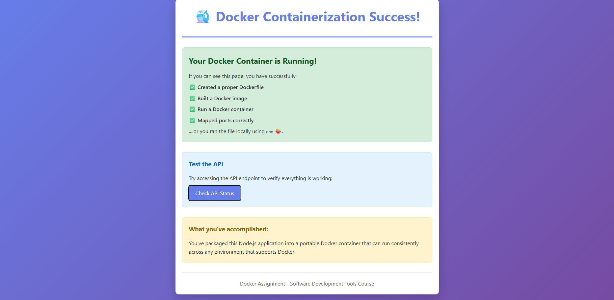
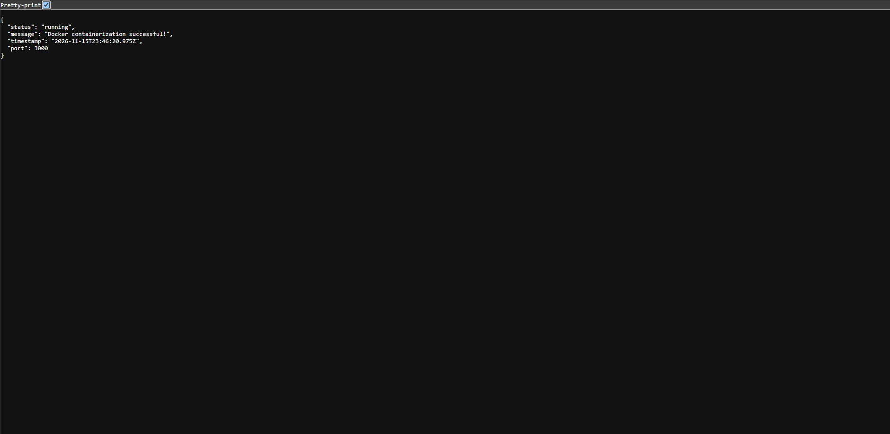

# Assignment #4: Application Containerization

This is a simple Node.js web application designed for learning Docker containerization concepts.

## Application Overview

This application is a basic Express.js web server that:
- Serves a static HTML page at the root (`/`)
- Provides an API status endpoint at `/api/status`
- Includes a health check endpoint at `/health`
- Runs on port 3000 by default (configurable via PORT environment variable)

## What's Included

- **app.js**: Main application server file
- **package.json**: Node.js dependencies and project configuration
- **public/index.html**: Static HTML page that confirms successful containerization
- **public/style.css**: Styling for the web page

## Running Without Docker (for reference only)

If you wanted to run this application directly (not required for assignment):
```bash
npm install
npm start
```

## Your Docker Assignment

**DO NOT MODIFY THE APPLICATION CODE**

Your task is to containerize this existing application using Docker. You need to:

1. Create a `Dockerfile` that properly containerizes this Node.js application
2. Build a Docker image from your Dockerfile
3. Run a container from your image
4. Verify the application works by accessing it in your browser


## Starting the Application

- To build the Docker image, run the command:

```bash
docker build -t assignment4-app .
```

- To run your Docker container on port 3000, run the command:

```bash
docker run -d -p 3000:3000 --name assignment4-container assignment4-app
```


## Reflection Question
**Answer the following question in the space below**: How does containerization with Docker differ from using virtual machines, and why might a development team choose Docker containers over VMs for deploying applications like the one you just containerized?

Docker containers and virtual machines both allow applications to run in separate environments, but they work differently. A virtual machine includes an entire operating system along with the application and its dependencies. Docker containers share the host operating system's kernel while keeping the application and its required dependencies isolated.

I think development teams might choose Docker because containers are generally more lightweight and faster to start than virtual machines. They also make it easier to move applications between different environments without having to install and configure every dependency separately. For example, with this assignment, I was able to run the Node.js application through Docker without needing to install Node.js directly on my computer. This makes development and deployment more consistent across a team. Virtual machines still have advantages when a project requires a completely separate operating system, but Docker is often a more efficient choice for deploying individual applications.


## Application Requirements for Docker

Your Dockerfile should ensure:
- The application has Node.js runtime available
- All application files are copied into the container
- Dependencies are installed (`npm install`)
- Port 3000 is exposed
- The application starts with `npm start`
- The container can be accessed from your host machine

## Verification

When your Docker container is running correctly:
- Navigate to `http://localhost:3000` (or whatever port you mapped)
- You should see a success page confirming containerization worked
- The `/api/status` endpoint should return JSON status information

## Troubleshooting Tips

- Make sure your port mapping is correct in the `docker run` command
- Check that all files are copied into the container
- Verify Node.js dependencies are installed in the container
- Use `docker logs <container-name>` to see application output

## File Structure Expected
```
docker-assignment/
├── Dockerfile          # You create this
├── app.js              # Provided
├── package.json        # Provided
├── public/             # Provided
│   ├── index.html      # Provided
│   └── style.css       # Provided
└── README.md           # This file
```

Good luck with your Docker containerization!


## Application Screenshots

### Application Running at localhost:3000



### API Response at localhost:3000/api/status


